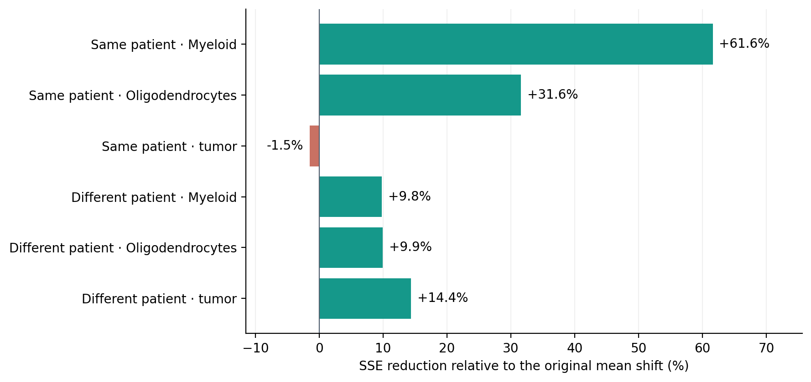
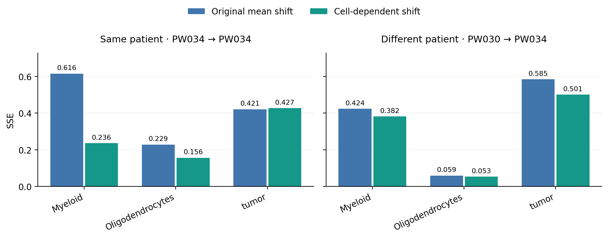
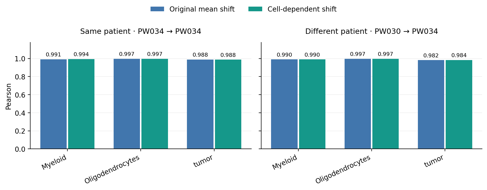
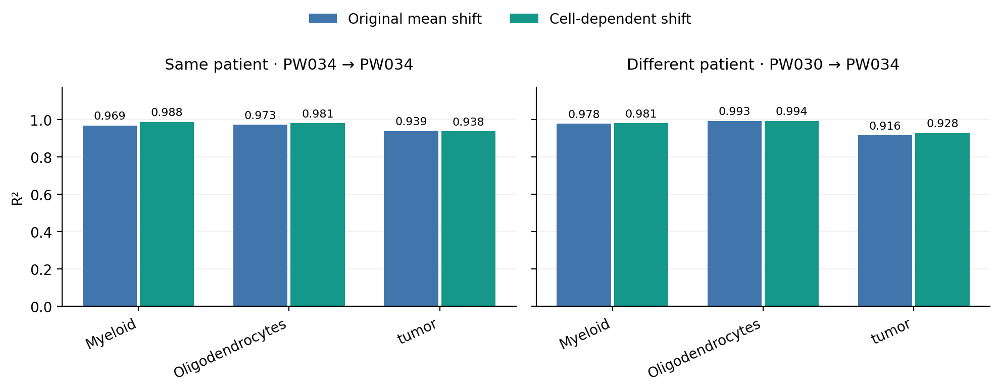

# Cell-dependent shifts for scDisInFact

Based on [the scDisInFact paper (Nature Communications, 2024)](https://doi.org/10.1038/s41467-024-45227-w) and its [original implementation](https://github.com/ZhangLabGT/scDisInFact).

In this project, we ask a small question: **can a shift that depends on the cell improve drug-response predictions compared with the original mean shift?** We test this on the paper’s glioblastoma (GBM) data. This is a limited, single-seed experiment, not a reproduction of every experiment in the paper.

## What the original method does

Single-cell RNA data describe how much RNA was measured for each gene in each cell. Here, cells come from different patients and were measured either with the drug **panobinostat** or with **DMSO**, the control without the drug. Patient differences are treated as batch effects.

scDisInFact uses an encoder to learn a shared representation of each cell and another encoder to learn treatment-related information. A decoder combines these representations with the batch label to reconstruct gene expression. Reconstruction, KL, MMD, classification, and group-lasso losses guide what the representations capture.

To predict treatment response, the original method calculates the difference between the mean treatment representations of drug and control cells. It adds this **same shift** to each input cell’s treatment representation, then decodes the result. The decoder can already produce different expression changes for different cells; the shift itself is shared.

## Our idea

We replace the mean shift with a small network that predicts a shift for each cell. It takes:

- the cell’s shared latent representation;
- its current treatment representation;
- the source and target treatment labels.

The network has two 64-unit hidden layers with ReLU. Its output is added to the treatment representation. It predicts the full shift; we do not add the original mean shift on top.

We first train scDisInFact, then freeze its encoders and decoder. We train only our shift network, while gradients pass through the frozen decoder. We use MMD to compare predicted expression with denoised target training cells from the **same patient and cell type**, after library-size normalization and `log1p`. Cell-type labels group the loss but are not network inputs.

## Experiment

We follow the paper’s GBM prediction task: hold out the treated sample **`PW034-705`** and predict it from control cells in two patients:

| Input → target patient | What changes? |
|---|---|
| PW034 → PW034 | Treatment only |
| PW030 → PW034 | Treatment and patient batch |

Both routes use the same held-out target sample. We evaluate Myeloid, Oligodendrocytes, and tumor cells separately.

We add a validation split of about 20% within each remaining patient × cell-type × treatment group. The paper’s GBM script does not reserve a separate validation set and fits its scaler before separating the test sample. We fit the scaler on training cells only and **retrain the original model on our split**, so the two methods share the same backbone and training data.

The backbone uses the authors’ GBM settings: latent dimensions `[8, 2]`, negative-binomial reconstruction, batch size 64, learning rate `5e-4`, and 100 epochs. Our network uses Adam with learning rate `1e-3`, 50 updates per epoch, and up to 100 epochs. We select the lowest-validation-MMD checkpoint and stop after 10 epochs without improvement. This run used **seed 0**; the network’s selected checkpoint was epoch 8.

## Results

Both methods are compared with the **same denoised test reference**, reconstructed by the frozen backbone. Following the paper, we normalize each cell’s expression to sum to 100 and compare mean gene expression within each cell type.

We report SSE, Pearson correlation, and R². The original GBM code calls its sum of squared errors “MSE”; our `paper_sse` column keeps that calculation explicit. The figures compare **our rerun of the original method** with our network, not with the paper’s published numbers.

| Route | Cell type | Original SSE | Our SSE | SSE reduction |
|---|---|---:|---:|---:|
| Same patient | Myeloid | 0.615898 | 0.236499 | **61.60%** |
| Same patient | Oligodendrocytes | 0.228535 | 0.156363 | **31.58%** |
| Same patient | tumor | 0.421067 | 0.427316 | −1.48% |
| Different patient | Myeloid | 0.423591 | 0.382145 | **9.78%** |
| Different patient | Oligodendrocytes | 0.059382 | 0.053476 | **9.94%** |
| Different patient | tumor | 0.584523 | 0.500640 | **14.35%** |



The network improves all three metrics in **five of six comparisons**. For tumor cells in the same patient, all three metrics are slightly worse. These results describe one held-out sample and one seed, using a model-derived denoised reference. They do not establish robust improvements across datasets or correct responses for individual cells.





The [result table](results/gbm_metrics.csv) includes the exact scores and source/target cell counts. The [notebook](notebooks/GBM_experiment.ipynb) shows the data, training, and evaluation outputs.

## Reports

To read breifly about the original paper and this experimnents, you may read the following reports:
- [Original paper report](reports/scDisInFact_report.pdf)
- [Our experiment report](reports/Cell-dependent%20shifts%20for%20scDisInFact_report.pdf)

## Run the experiment

Use Python 3.12. The requirements list the package versions used in our run. We used PyTorch 2.7.1 with CUDA 12.6 on an RTX 3060; install the appropriate CUDA build of PyTorch for the target machine before installing the requirements.

```bash
python -m pip install -r requirements.txt
python -m cellshift.download gbm
```

Open [notebooks/GBM_experiment.ipynb](notebooks/GBM_experiment.ipynb) with the installed Python environment. `RESUME_DIRECTORY=None` starts a new run. Set it to a saved run directory to reuse compatible checkpoints and scores. The final results cell can also read saved scores without retraining.

For command-line execution:

```bash
python -m cellshift.run --experiment gbm --seed 0 --device cuda
python -m cellshift.report
```

Data come from the authors’ [Zenodo archive](https://zenodo.org/records/10472715); the compressed GBM download is about 452 MB. The original preprocessing creates large dense matrices, so sufficient system RAM is needed. Data and checkpoints are excluded from Git; the notebook, exported result table, and figures are included. Regenerate the README figures with `python scripts/plot_results.py`.

## Source and license

The upstream model is retained under `vendor/scDisInFact`, pinned to [revision `9466ecf`](https://github.com/ZhangLabGT/scDisInFact/tree/9466ecf257d923f879cb39712c530d24826d88bc). The original model implementation is unchanged. Our shift network, experiment code, and evaluation utilities are in `cellshift/` (November 2026).

The original authors’ notices and GPL-3.0 license are preserved. This project uses the same [license](LICENSE).
